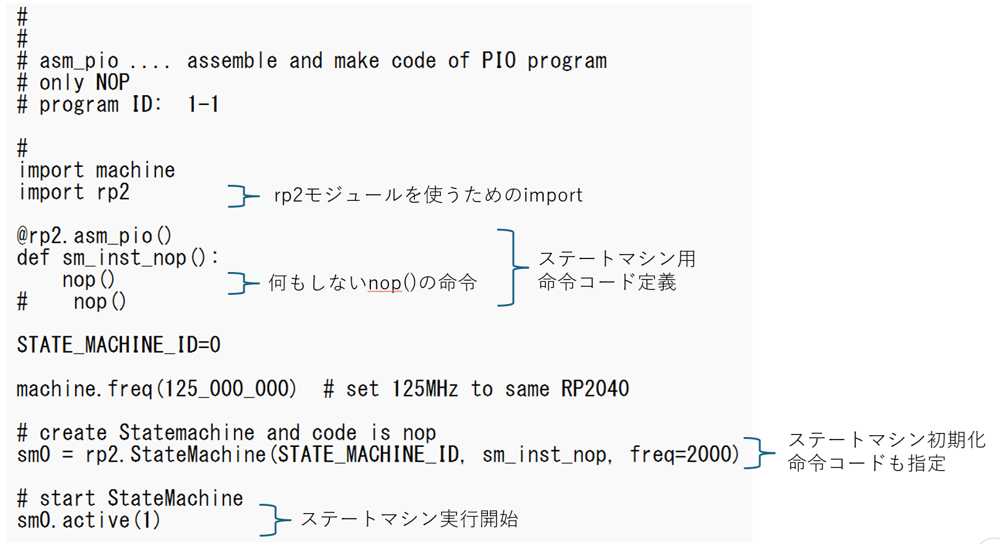

# 最もシンプルなプログラム、NOP
何も実行しない最もシンプルなプログラムを作成します。何も実行しないプログラムなので、GPIOに信号を出力することもしません。命令語としてはnop()を使用します。プログラムは以下です。

### プログラムの説明
- デコレータ、@rp2.asm_pio()を付けることで、続く関数がステートマシン用のプログラムであることを指定します。アセンブルされます。
- ステートマシン用プログラムの関数名は任意であり、目的に合った分かりやすい関数名を付けることができます。
- rp2.StateMachine()において、ステートマシンを初期化します。初期化時、どのステートマシンを使うか、ステートマシンを制御するためのプログラムを指定します。
- 初期化されたステートマシンに対して、sm0.active(1)を実行することで、ステートマシンが実行されます。一度実行を始めるとステートマシンはずっと動き続けます。止める場合は、sm0.active(0)を実行します。
- nop()命令はステートマシンの命令としては存在しません。nop()命令で生成されるアセンブルされたコードは、move x, x です(確か)。Xレジスタの値をXに書き込むという副作用の発生しない命令を実行します。
