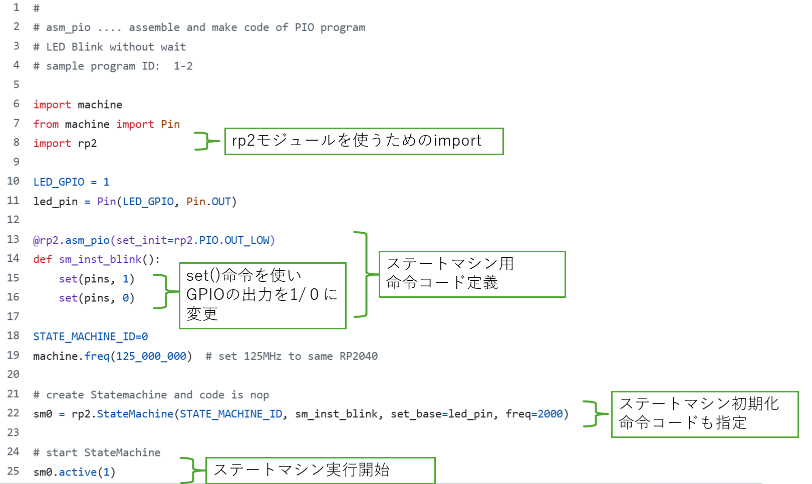

# GPIOのPinを1/0繰り返すプログラム(PIO版Lチカ）
次は、PIOを使って、GPIOのPinを1/0/1/0... と繰り返すプログラムを作ります。NOPプログラムはGPIOを使いませんでしたが、BlinkプログラムではGPIOのPinに対してPioから制御を行います。Pinの値を変える方法として、以下の３種類あります
1. GPIOで出力したい固定値をset命令を使ってアセンブラコード内で指定した値をGPIOに書き込む
2. GPIOで出力したい値を各種レジスタ(X,Y,OSR,ISR)に書き込んでおき、MOVE命令を使ってレジスタからGPIOに値を移動する
3. GPIOで出力したい値をOSRに書き込んでおき、OUT命令を使ってOSRからシフトしながらGPIOに値を移動する

まずは、レジスタを使わず、アセンブラコードだけでGPIOを制御できるSET命令によるGPIO操作のコードを示します。昔のアセンブラ時代の直値指定（イミディエートモード）と同じ考え方です。

### set()命令を使ったプログラムの説明
- 本プログラムではLEDを点滅させます。どのPinを使うのか指定する必要があります。11行目において、使うPinを初期化しています。
- 関数 set_inst_blink()において、set()命令を使ってGPIOを操作するコードを定義しています。set(pins,1)とすることで、GPIOのPinに対して1を設定します。結果、GPIOのPinはHになります。また、set(pins,0)とすることで、GPIOのPinに対して0を設定し、GPIOのPinはLになります。
- rp2.StateMachine()において、ステートマシンを初期化します。初期化時、どのステートマシンを使うか、ステートマシンを制御するためのプログラム、使用するGPIOのPinを指定します。
- 初期化されたステートマシンに対して、sm0.active(1)を実行することで、ステートマシンが実行されます。
- 上記サンプルコードではLEDの点滅速度を最低限まで落とすため、周波数を指定しています。省略した場合、マシンクロックと同じ周波数でステートマシンが実行されます。マシンクロックが150MHzの場合、点滅する周波数は75MHzになります。
