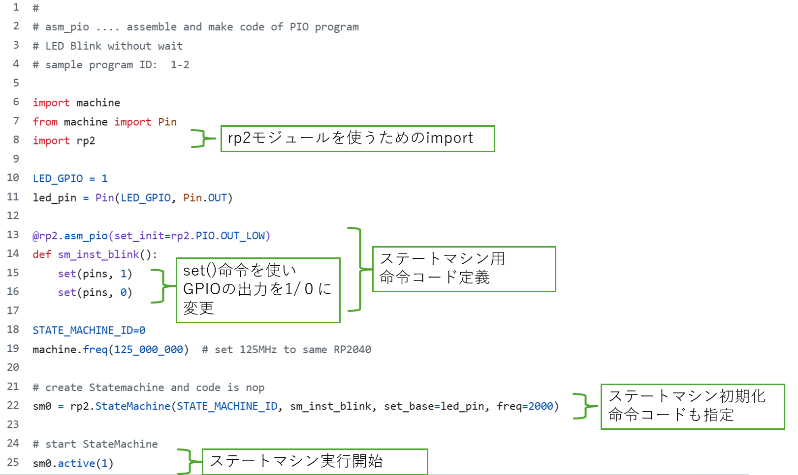

# GPIOのPinを1/0繰り返すプログラム(WAIT機能付き）
先ほどはLED点滅プログラムを作りましたが早すぎて本当に点滅しているのか見た目で判断が付きません。ステートマシン内でWAIT LOOPを入れることで、一定時間待ってから点滅するように修正します。
一般的な待ちループは以下のフローとなります。
```
   変数：[カウンタ]　<===  ループ回数指定
ラベル：loop
   <変数[カウンタ]の値は0か？>
       もし0なら、ラベル：exitに分岐
       もし0でないなら、変数：[カウンタ]から1減算、ラベル：loopに分岐
ラベル：exit
```
PIO内には汎用のXレジスタ、Yレジスタがありますので、このレジスタをカウンタとして使ってレジスタの値が0になるまで減算しながらループさせて遅延を発生させます。
命令語には待ちループに適した減算機能付きのjmp命令があります。これを使って、待ちループを実装します。

参考資料：[jmp命令説明](https://github.com/foobarbazfred/micropython/blob/main/rp2350_pio/instruction_ja.md#jmpcond-label)

jmp命令の書式は以下です
```
条件付きジャンプ
jmp([cond], label)
   condに条件を書き、一致したらlabelのアドレスに分岐、一致しない場合次の行に進む
```
condの部分に分岐判断の条件を指定します。x_decと指定することで、xレジスタが0になるまで減算しならがループします
```
set(x,0x1f)
label('wait_loop')
nop()
jmp(x_dec, wait_loop)
```
### プログラムの説明
- ループカウンタとしてXレジスタを用います
- Xレジスタに直値として0x1Fを設定します（使える最大値が1F）
- loopできるよう、ラベルを定義します。ラベル名は好きな名前を使えますが、ここでは wait_loopとします
- nop()で１命令分の遅延を発生させます
- jmp命令で、Xレジスタが0であるか判断します。0でないなら、Xレジスタを１減算してwait_loopに分岐します。Xレジスタが0であれば分岐せず次の行に進みます

このループの場合、待たせることができる時間を試算します。現在1命令##msecであり、待ちループが1Fですので、＃＃＃の待ちが発生します。


### set()命令を使ったプログラム
まずは、レジスタを使わず、アセンブラコードだけでGPIOを制御できるSET命令によるGPIO操作のコードを示します。昔のアセンブラ時代の直値指定（イミディエートモード）と同じ考え方です。

ソースコード：[2-1-led-blink.py](src/2-1-led-blink.py)



### プログラムの説明
- 本プログラムではLEDを点滅させます。どのPinを使うのか指定する必要があります。11行目において、Pin(1,Pin.OUT)関数により、LEDを点滅させるためのPinをGP01として初期化しています。
- 関数 set_inst_blink()において、set()命令を使ってGPIOを操作するコードを定義しています。set(pins,1)とすることで、Pinに対して1を設定します。結果、PinはHになります。また、set(pins,0)とすることで、Pinに対して0を設定し、PinはLになります。どのPinを使うか？はステートマシン用コード内では指定しません。ステートマシン初期化時に指定します。
- rp2.StateMachine()において、ステートマシンを初期化します。初期化時、どのステートマシンを使うか、ステートマシンを制御するためのプログラム、使用するGPIOのPinをset_baseの値として指定します。今回はGP01を出力先のPinとして使用されます。
- 初期化されたステートマシンに対して、sm0.active(1)を実行することで、ステートマシンが実行されます。０番目のステートマシンにおいて、set(pins,1), set(pins,0)が連続実行されます。
- 上記サンプルコードではLEDの点滅速度を最低限の速度まで落とすため、周波数を2KHzと指定しています。この結果、LEDの点滅周波数は1KHzになります。クロックを省略した場合、マシンクロックと同じ周波数でステートマシンが実行されます。例えばマシンクロックが150MHzの場合、点滅する周波数は75MHzになります。
- set()命令の注意点として、機械語が16ビット長で実装されており、直値(イミディエート値)を保持する領域が5bitです。よって、直値で指定できる値は０から最大0x1Fまでに制限されます。詳しくは参考資料をご参考ください。

### 参考資料
- SET命令説明 https://github.com/foobarbazfred/micropython/blob/main/rp2350_pio/instruction_ja.md#setdest-data
