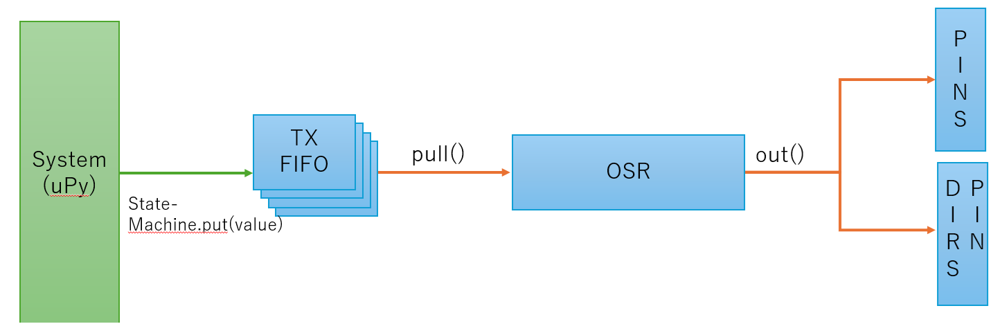

# MicroPythonからPIOを経由して周辺デバイスにデータを出力する
これまではPIO内部のステートマシン用のプログラムだけで入出力を制御してきました。この章では、PIOから周辺デバイスにシリアルデータを出力するサンプルを作ります。マイコン側から出力するには、TX FIFOを介してOSRにデータを書き込みます
OSRからビット単位でシフトしながらGPIO Pinに特定ビット単位でデータを出力します。この章では、1bitデータをシリアルで送出する場合を考えます。プログラムで使うレジスタとデータの流れは以下の通りです。



- MicroPython側からは、StateMachine.put（）コマンドを使ってTX FIFOに値を書き込みます。TX FIFOは#段のFIFOとなっています。
- PIO側では以下の処理を行います
  - pull()命令を使って、TX FIFOからデータを読み込みOSRに書き込みます
  - out()命令を使って、OSRから指定されたbit幅分シフトして指定されたGPIO Pinに書き込みます
  - この処理を必要回数行います。例えば、8bitシリアルデータの場合、1bitシフトを8回行います 

1語が8bitのデータをPin#からシリアル化して出力するサンプルコードは以下です。まずはステートマシンのコードを示します。
```
```
